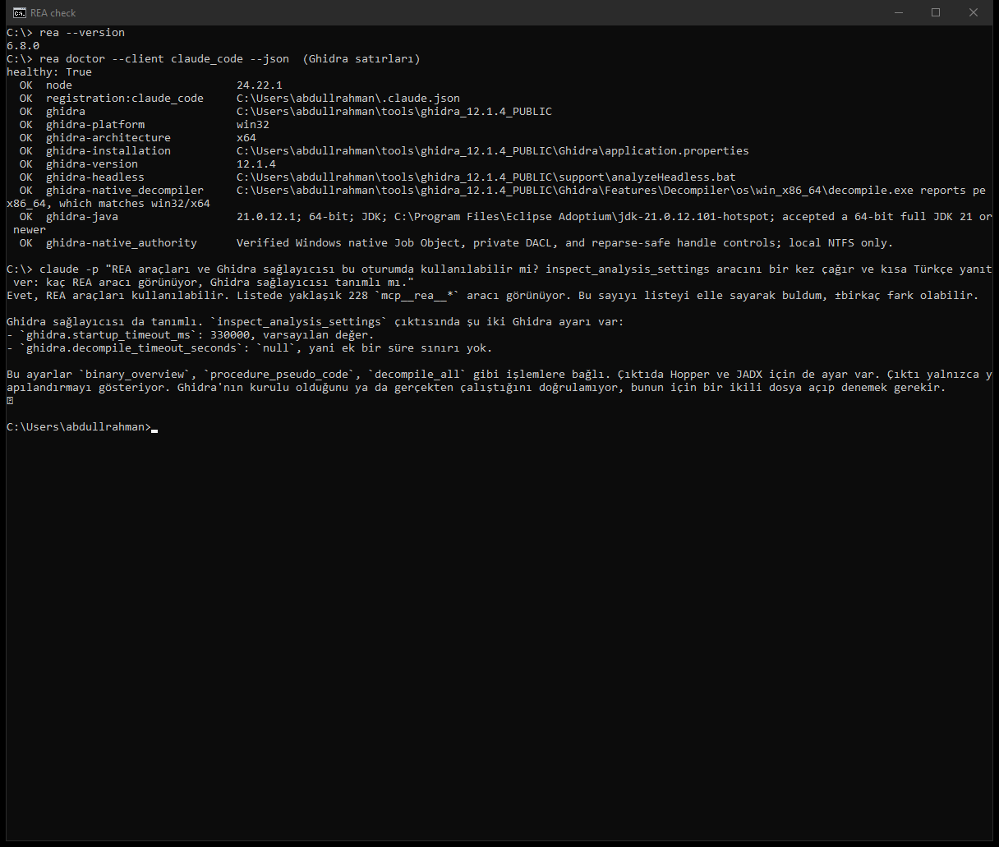

# YZM301 Teardown Sprint — t testi, eşleştirilmiş ortalama (t-paired)

> **Yapılan katmanlar:** ☑ CLI (temel) · ☑ MCP sunucusu (+15) · ☐ AI ajanı (+10)

Bu repo, bir güç analizi aracının **eşleştirilmiş t testi** (örnek senaryo: aynı hastada
tedavi öncesi ve sonrası tansiyon) hesabının tersine mühendislikle incelenmesini, kanıt
defterini, temiz oda yeniden yazımını ve ajan çağına taşınmasını içerir.

Bu yeniden yazım G*Power **değildir** ve onun yerine geçmez. Referans (kâhin) olarak
G*Power 3.1.9.7 kullanılmıştır.

## Atıf

- Faul, F., Erdfelder, E., Lang, A.-G., & Buchner, A. (2007). G*Power 3: A flexible
  statistical power analysis program for the social, behavioral, and biomedical sciences.
  *Behavior Research Methods, 39*, 175–191.
- Faul, F., Erdfelder, E., Buchner, A., & Lang, A.-G. (2009). Statistical power analyses
  using G*Power 3.1: Tests for correlation and regression analyses.
  *Behavior Research Methods, 41*, 1149–1160.

G*Power yalnızca resmi sayfasından dağıtılır: https://www.psychologie.hhu.de (G*Power sayfası).

## Sürüm bilgisi

| Öğe | Değer |
|---|---|
| İncelenen sürüm | G*Power 3.1.9.7 (Windows), `GPowerWin_3.1.9.7.zip` (resmi sayfa) |
| İkili dosya | Arşivdeki çalıştırılabilir dosyanın adı `GPowerNT.exe` (yönergedeki "GPower.exe") |
| GPowerNT.exe SHA-256 | `c63e6a133eb6372932f810c08cc33dc35a06d1ddb658f897bd6c34a754efc812` |
| Ghidra | 12.1.4 (`ghidra_12.1.4_PUBLIC_20260921.zip`, SHA-256 `ddac49f9…d2d4db` doğrulandı) |
| JDK | Eclipse Temurin 21.0.12 |
| REA (rea-agents) | 6.8.0 (npm, `github.com/morluto/rea`) |
| Node.js | 24.22.1 |

## Ortam kontrolü

Ajana sorulan soru: *"REA araçları ve Ghidra sağlayıcısı bu oturumda kullanılabilir mi?"*

 <!-- TODO: ekran görüntüsünü docs/ altına koyun -->

## Kurulum

```bash
# 1) Ortamı kontrol et (JDK 21, Ghidra, REA, Python paketleri, GPower.exe hash)
powershell -ExecutionPolicy Bypass -File scripts/check-env.ps1 -GPowerExe "C:\Program Files\G*Power\GPower.exe"

# 2) Python bağımlılıkları
python -m pip install -r requirements.txt

# 3) Paketi kur (gpower-clone ve tpaired-mcp komutları)
python -m pip install -e .
```

## Çalıştırma (CLI sözleşmesi)

Hesap mantığı yalnızca `src/tpaired/engine.py`'dedir. CLI (`src/tpaired/cli.py`) ve MCP sunucusu
(`src/tpaired/mcp_server.py`) aynı ince katmanı (`src/tpaired/output.py`: alan adları + 4 basamak
yuvarlama) çağırır; hesap yapmazlar.

```bash
gpower-clone --test t-paired --mode a-priori --tails 2 --dz 0.5 --alpha 0.05 --power 0.95
# {"n_total":54,"actual_power":0.9502,"critical":2.0057,"df":53,"ncp":3.6742}

gpower-clone --test t-paired --mode post-hoc --tails 2 --dz 0.5 --alpha 0.05 --n 30
# {"n_total":30,"power":0.754,"critical":2.0452,"df":29,"ncp":2.7386}

# Kurulum yapmadan, aynı CLI:
PYTHONPATH=src python -m tpaired --test t-paired --mode a-priori --tails 2 --dz 0.5 --alpha 0.05 --power 0.95
```

- `--dz` yerine `--d`, `--n` yerine `--n-total` da kabul edilir (`docs/CONTRACT-notes.md`; ikisi birden verilirse hata).
- Çıktı her zaman tek satır JSON. Geçersiz girdide `{"error":"..."}`; çıkış kodu girdi doğrulama
  hatasında 1, argüman hatasında 2.
- Windows'ta Microsoft Store Python'u kullanılıyorsa `gpower-clone.exe` kullanıcı `Scripts` klasörüne
  kurulur; o klasör PATH'te değilse `python -m tpaired` kullanın.

### Testler

```bash
python -m pytest            # SPEC §6 senaryoları, 72 GUI + 577 statsmodels vektörü, CLI, MCP
python tests/make_report.py # tests/REPORT.md'yi yeniden üretir
```

Uyum özeti (`tests/REPORT.md`): GUI vektörlerinde 17/17 hata satırı, 52/52 hesaplanabilir satırda N tam
ve tüm ondalıklı alanlar 1e-7 içinde; 3 satır SPEC §7 bilinen sapma (N > 10¹⁰).

## MCP sunucusu (+15)

Resmî `mcp` Python SDK'sı (2.x, `MCPServer`), stdio taşıması:

```bash
tpaired-mcp                     # ya da: PYTHONPATH=src python -m tpaired.mcp_server
```

İstemci yapılandırması örneği (Claude Desktop / Claude Code `mcpServers`):

```json
{ "mcpServers": { "tpaired-power": { "command": "python", "args": ["-m", "tpaired.mcp_server"] } } }
```

Tek araç: **`t_paired_power`** — CLI ile aynı motoru ve aynı çıktıyı kullanır (`tests/test_mcp.py`
72 GUI vektörü + statsmodels örneklemi üzerinde CLI ile birebir aynı JSON'u doğrular, ayrıca gerçek
stdio alt sürecini dener).

Girdi şeması:

| Alan | Tip | Zorunlu | Açıklama |
|---|---|---|---|
| `mode` | string | evet | `"a-priori"` veya `"post-hoc"` |
| `tails` | integer | evet | `1` veya `2` |
| `dz` | number \| string | evet | Etki büyüklüğü dz, −20…20; sayı değilse 0 sayılır |
| `alpha` | number | evet | 1e-7…0.9999999 |
| `power` | number \| null | a-priori'de | Hedef güç, α…0.9999999 |
| `n` | number \| null | post-hoc'ta | Çift sayısı (yarım yukarı yuvarlanır), 3…2147483646 |

Çıktı (`structuredContent`, metin içeriği aynı JSON):

- a priori: `{"n_total", "actual_power", "critical", "df", "ncp"}`
- post hoc: `{"n_total", "power", "critical", "df", "ncp"}`
- geçersiz girdi: `{"error": "..."}`

## Repo yapısı

| Yol | İçerik |
|---|---|
| `SPEC.md` | Gherkin kabul kriterleri (Oturum 1 üretir) |
| `LEDGER.md` | Kanıt defteri — [DOK] / [REA] / [AJAN] |
| `HALLUCINATIONS.md` | Ajanın yanlış çıkardığı şeyler ve yakalayan testler |
| `AGENT_COST.md` | Ajan, token, maliyet, iterasyon |
| `prompts/` | İki oturumun ilk prompt'ları |
| `oracle/` | G*Power vektörleri (CSV) + ekran görüntüleri, statsmodels ölçek vektörleri |
| `src/tpaired/` | `engine.py` (tek hesap motoru), `output.py`, `cli.py`, `mcp_server.py` — Oturum 2 yazar |
| `tests/` | SPEC senaryo testleri, diferansiyel testler, `REPORT.md` uyum raporu |
| `scripts/` | Ortam kontrolü, GUI kâhin toplayıcı (`collect_gpower.py`), statsmodels kâhini |

## Kâhin

- `oracle/gpower_vectors.csv`: G*Power arayüzünden 72 vektör (17'si geçersiz girdi), her biri
  `oracle/screenshots/<id>.png` ile. `scripts/collect_gpower.py` arayüzü Win32 UI Automation ile sürer;
  hesap yapmaz, yalnızca ekrandakini kaydeder.
- `oracle/statsmodels_vectors.csv`: 577 ölçek vektörü (kesirli N).

## Demo

60 saniyelik CLI videosu: `TODO — link`
